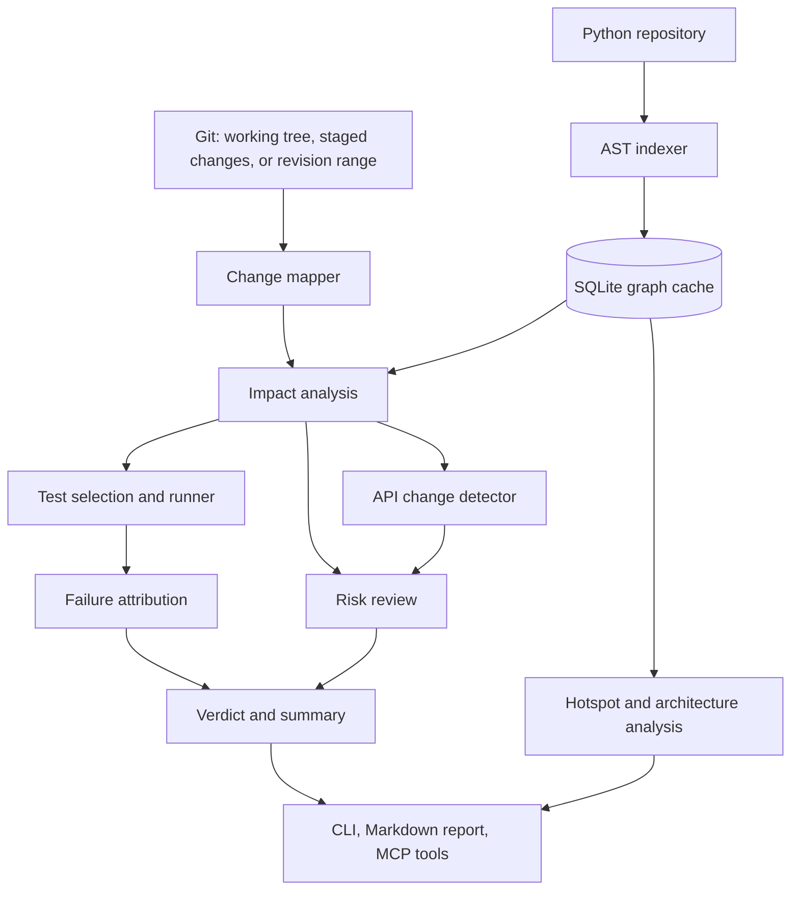

# CodeAtlas

**Code intelligence for Python repositories — understand change impact, identify relevant tests, and get one clear verdict on a change before you merge it.**

CodeAtlas is a code intelligence tool that works as an **MCP server for AI assistants** and a **CLI for developers and CI pipelines**. It builds a persistent graph of symbols, imports, function calls, and related code relationships to help developers understand how a code change may affect the rest of a Python codebase.

Traditional search tools find where a function is mentioned. CodeAtlas goes further by analyzing code relationships, tracing potential impact, detecting breaking API changes, selecting and running relevant tests, linking failures back to the code that probably caused them, and explaining factors that may make a change risky.

> Change a function. Understand what could break, which tests matter, whether they pass, and which change is the likely cause — before you merge.

**Current version: 0.3** — see [What's New in 0.3](#whats-new-in-03).

---

## Table of Contents

- [Why CodeAtlas?](#why-codeatlas)
- [What's New in 0.3](#whats-new-in-03)
- [Key Features](#key-features)
- [Architecture](#architecture)
- [How It Works](#how-it-works)
- [Technology Stack](#technology-stack)
- [Installation](#installation)
- [Quick Start](#quick-start)
- [Choosing What to Review](#choosing-what-to-review)
- [CLI Commands](#cli-commands)
- [Understanding the Output](#understanding-the-output)
- [Example: Change Impact Analysis](#example-change-impact-analysis)
- [Regression Detection Demonstration](#regression-detection-demonstration)
- [MCP Integration](#mcp-integration)
- [CI Integration](#ci-integration)
- [Storage and Configuration](#storage-and-configuration)
- [Risk Analysis and Test Selection](#risk-analysis-and-test-selection)
- [Architecture Health](#architecture-health)
- [Security Considerations](#security-considerations)
- [Troubleshooting](#troubleshooting)
- [Known Limitations](#known-limitations)
- [Roadmap](#roadmap)
- [Contributing](#contributing)
- [License](#license)

---

## Why CodeAtlas?

When developers modify a function in a large repository, several questions arise:

- Which functions and modules depend on this change?
- Which tests should be executed?
- Could the change break downstream functionality, or break callers by changing a function signature?
- If tests fail, which part of my change is the likely cause?
- Are important code paths insufficiently tested?
- Which files have accumulated high complexity and frequent changes?
- How can an AI coding assistant understand the impact of a proposed change?

Running every test after every small change can be expensive. Running only tests that directly cover the changed function can miss regressions in dependent modules.

CodeAtlas addresses this problem through persistent code indexing, Git-aware change analysis, dependency tracing, affected-test selection, and failure attribution.

## What's New in 0.3

**New capabilities**

- **One-call review with a verdict.** `review_and_test` (CLI: `codeatlas check`) runs risk review, impact analysis and the affected tests, then returns a single verdict: `pass`, `fail`, `unverified`, `no_changes` or `pass_with_preexisting_failures`, plus a plain-English summary.
- **Failure attribution.** Failing tests are linked to the changed symbols they reach, and `likely_causes` ranks those symbols (for example, "`shop.pricing.clamp` is reached by 5 failing tests").
- **Test failures raise the risk level.** A change that breaks its own tests is reported as `high` risk even when the static estimate was `low`; both values are shown.
- **Breaking API-change detection.** Removed functions, changed signatures (renamed or removed parameters, new required parameters, lost defaults, reordered positional parameters) and the callers that still use them.
- **Review exactly what you want.** `scope` (`all`, `staged`, `unstaged`) works with `git add .` workflows, and a clean working tree falls back to the last commit instead of reporting "no changes".
- **Baseline comparison.** `--baseline` re-runs the failing tests on the pre-change code in a temporary Git worktree and labels each failure `new` or `pre-existing`.
- **New tools:** `get_diff`, `get_symbol_source`, `review_and_test`.
- **Markdown report** for pull-request comments (`--format markdown`).
- **Works with `mcp` 1.x and 2.x**, async tools, read-only tool hints, and a test suite for CodeAtlas itself.

**Reliability fixes**

- Tests run with the project's own Python (`.venv`/`venv`, or `CODEATLAS_PYTHON`) instead of the server's interpreter.
- One pytest run instead of a separate collection pass; timeouts kill the whole process tree (including `taskkill /T` on Windows).
- Plugin isolation (`PYTEST_DISABLE_PLUGIN_AUTOLOAD`) is now opt-in, so pytest-asyncio, pytest-django and similar plugins keep working.
- `rev_range` is validated before it reaches Git; the diff parser no longer mistakes removed `-- comment` lines for file headers; paths with spaces and non-ASCII characters are handled.
- Import-cycle detection is iterative (no recursion-limit problems); outputs report when lists are truncated; parallel tool calls no longer contend for the SQLite cache.

**Output changes to be aware of** (relevant if you parse the JSON): `run_affected_tests` now returns a `status` field (`passed | failed | error | timeout | no_tests | no_changes`), `stdout_tail`/`stderr_tail` instead of `log_tail`, and failures include `locations`, `traceback` and `linked_changes`. `total_test_files` no longer counts `__init__.py` or `conftest.py`.

---

## Key Features

| Feature | Description |
|---|---|
| Persistent code indexing | Stores code symbols and relationships in a persistent graph backed by SQLite. |
| Symbol discovery | Locates function and class definitions and returns their full source. |
| Reference analysis | Identifies references and potential callers using available graph relationships. |
| Change impact analysis | Identifies potentially affected functions, modules, and tests. |
| Breaking API-change detection | Reports removed or re-signed functions and the callers that still use them. |
| Git-aware analysis | Analyzes uncommitted work (all, staged or unstaged) or any Git revision range. |
| Affected-test selection | Selects test files associated with the affected dependency graph. |
| Automated test execution | Runs selected tests with the project's interpreter and reports passes, failures, errors and timeouts. |
| Failure attribution | Links failing tests to the changed symbols that probably caused them. |
| Baseline comparison | Separates new failures from failures that already existed before the change. |
| Change risk review | Reports a heuristic risk score with reasons; failing tests override it. |
| Single verdict | `review_and_test` returns one pass/fail/unverified verdict with a summary. |
| Hotspot detection | Identifies files with elevated churn and complexity. |
| Architecture health | Import-cycle detection, dead-code candidates and most-complex functions. |
| MCP integration | Exposes the operations above as tools for compatible AI assistants. |
| CLI and CI integration | Commands, exit codes and a Markdown report for local use and pipelines. |

CodeAtlas uses static analysis, so its findings represent potential impact rather than a guarantee that every runtime dependency has been discovered.

---

## Architecture



### Core Components

**1. Python AST Indexer** (`indexer.py`)

Parses Python source code and extracts definitions, imports, function calls, and other structural information. Unchanged files (by content hash) are skipped on later runs.

**2. Persistent Code Graph** (`graph.py`)

Stores code entities and their relationships and provides reverse lookups such as callers-of, call closure and import closure.

**3. Git Change Analyzer** (`gitutil.py`)

Collects changed line ranges for the working tree, the staging area, or a revision range; validates revision input; falls back to the last commit when the working tree is clean; reads file contents at a revision.

**4. Impact Analysis Engine** (`analysis.py`)

Maps changed lines to symbols, traverses call and import relationships, detects API changes, and computes the risk review.

**5. Test Runner and Attribution** (`runner.py`, `attribution.py`)

Selects candidate test files, runs them with the project's interpreter, parses the results, optionally compares with a baseline, and links failures to changed symbols.

**6. Workflow and Reporting** (`workflow.py`, `report.py`)

Combines review, impact and test results into one verdict and renders Markdown for pull-request comments.

**7. CLI and MCP Interfaces** (`cli.py`, `server.py`)

Expose the operations to developers, automation tools, and compatible AI assistants.

---

## How It Works

### Step 1: Index the repository

CodeAtlas parses the Python repository and records symbols and dependency relationships. Every analysis command refreshes the index incrementally, so you rarely need to run this yourself.

```powershell
codeatlas index --repo "C:\path\to\your\python-project"
```

### Step 2: Persist the analysis

CodeAtlas stores the code graph and indexing metadata in SQLite outside your repository. Content hashes determine which files need to be reparsed on later runs.

### Step 3: Detect changes

Git provides the changed lines for the requested scope or revision range (see [Choosing What to Review](#choosing-what-to-review)). CodeAtlas maps changed lines to the affected symbols where its static analysis can resolve them, and compares function signatures before and after to detect API changes.

### Step 4: Trace potential impact

The analyzer follows available call and import relationships to identify functions, modules, and tests that may be affected.

### Step 5: Select and run relevant tests

The test-selection engine identifies candidate tests based on the dependency graph and runs them with pytest. If configuration or dependency files changed, all tests run.

### Step 6: Attribute failures and decide on a verdict

Failing tests are linked to the changed symbols they reach. Optionally, the same tests are run on the pre-change code to separate new failures from pre-existing ones. The verdict combines the test status with the risk review.

### Step 7: Make a decision

Developers can use the verdict, likely causes and API-change report to investigate a regression, fix the implementation, and decide whether the change is ready for review.

---

## Technology Stack

| Technology | Purpose |
|---|---|
| Python 3.10+ | Core implementation |
| Python AST | Static source-code analysis |
| SQLite | Persistent graph and indexing storage |
| Git (via GitPython) | Change and revision analysis |
| pytest | Python test execution |
| MCP SDK (`mcp` 1.x or 2.x) | Integration with AI coding assistants |
| GitHub Actions | Potential continuous integration integration (example below) |
| Docker | Potential isolated execution and deployment |

---

## Installation

### Requirements

- Python 3.10 or newer
- Git (on `PATH`)
- pip
- A Python repository to analyze, with pytest available for its tests
- Node.js and `npx` if using MCP Inspector
- An MCP-compatible client if using AI-assisted analysis

### 1. Get CodeAtlas

Replace the example URL with your actual repository URL, or unzip the release archive.

```powershell
git clone <YOUR_CODEATLAS_REPOSITORY_URL>
cd codeatlas
```

Use the directory containing `pyproject.toml` as the project root.

### 2. Create a virtual environment

**Windows PowerShell**

```powershell
python -m venv .venv
.\.venv\Scripts\Activate.ps1
```

**Linux / macOS**

```bash
python -m venv .venv
source .venv/bin/activate
```

### 3. Install

```bash
python -m pip install --upgrade pip
pip install -e ".[dev]"
```

This installs CodeAtlas in editable mode with its dependencies (`mcp`, `GitPython`) and pytest, and provides the `codeatlas` and `codeatlas-mcp` commands. If an older CodeAtlas is installed in another environment (for example conda `base`), uninstall it there so the old version is not picked up by mistake.

### 4. Run the project tests

```bash
python -m pytest tests -q
```

The suite builds small temporary Git repositories, so it needs `git` and takes a minute or two (longer inside synced folders such as OneDrive).

---

## Quick Start

The following example uses Windows PowerShell.

### 1. Configure repository access

Set the root directory that CodeAtlas is allowed to access:

```powershell
$env:CODEATLAS_ROOTS = "C:\Users\YourUser\OneDrive\Desktop"
```

Replace the path with the directory containing your target repositories. This setting applies to the current PowerShell session; configure it again in a new terminal if needed.

### 2. Review your changes with one command

```powershell
codeatlas check --repo "C:\path\to\your\python-project"
```

This reviews uncommitted work (or the last commit if the working tree is clean), runs the affected tests, and prints a JSON result with a `verdict` and `summary`. The exit code is `0` for pass and `1` for fail, which makes it usable in scripts.

For a readable report:

```powershell
codeatlas check --repo "C:\path\to\your\python-project" --format markdown
```

### 3. Or use the individual steps

```powershell
codeatlas index  --repo "C:\path\to\your\python-project"
codeatlas review --repo "C:\path\to\your\python-project"
codeatlas impact --repo "C:\path\to\your\python-project"
codeatlas test   --repo "C:\path\to\your\python-project"
```

An initial indexing operation may report statistics such as:

```json
{
  "files": 7,
  "reparsed": 7,
  "removed": 0,
  "symbols": 13,
  "calls": 26,
  "imports": 9,
  "parse_errors": [],
  "full_reindex": true
}
```

These values are an example from a sample repository, not a guarantee for every repository.

### 4. Review a specific Git range

```powershell
codeatlas check --repo "C:\path\to\your\python-project" --range HEAD~1..HEAD
```

The range `HEAD~1..HEAD` compares the current commit against its immediate parent. For pull requests, choose a range whose base and head represent the intended comparison, and make sure the base revision is available locally.

---

## Choosing What to Review

| You want to review | Options | Compared |
|---|---|---|
| Uncommitted work (default) | none | working tree vs `HEAD` (staged + unstaged + untracked files) |
| Only what `git add .` staged | `--scope staged` | staging area vs `HEAD` |
| Only unstaged edits | `--scope unstaged` | working tree vs staging area (plus untracked files) |
| The last commit | `--range HEAD~1..HEAD` | that commit |
| A whole branch | `--range main..HEAD` | `main`..`HEAD` |
| A pull request | `--range origin/main...HEAD` | merge-base of both → `HEAD` |

**Clean working tree.** If nothing is uncommitted, CodeAtlas analyzes the last commit instead and says so in `notes` (`fallback_used: true`). Disable this with `--no-fallback` (MCP: `fallback_to_last_commit=false`).

**Range accuracy.** With an explicit range, line ranges come from Git but the call graph is built from the checked-out working tree, so results are most accurate when the end of the range is checked out.

---

## CLI Commands

```text
codeatlas <command> [name] [options]
```

| Command | Purpose |
|---|---|
| `check` | Review + impact + affected tests with one verdict (exit `1` on fail) |
| `review` | Static risk score, reasons and suggested tests |
| `impact` | Changed symbols, affected functions/modules/tests, API changes |
| `test` | Run the affected tests and report results (exit `1` on failure, error or timeout) |
| `diff` | Show the diff being analyzed |
| `symbol <name>` | Locate a function, class or method |
| `source <name>` | Print the full source of a function, class or method |
| `refs <name>` | List callers and references |
| `hotspots` | Files with high churn and complexity |
| `health` | Import cycles, dead-code candidates, most complex functions |
| `index` | Build or refresh the index |

| Option | Applies to | Meaning |
|---|---|---|
| `--repo PATH` | all | Repository to analyze (default `.`); must be inside `CODEATLAS_ROOTS` |
| `--range A..B` | review, impact, test, check, diff | Git revision range |
| `--scope all\|staged\|unstaged` | same | Which uncommitted changes to include |
| `--no-fallback` | same | Do not analyze the last commit when the tree is clean |
| `--timeout SECONDS` | test, check | Test run timeout (default 120) |
| `--baseline` | test, check | Also run the tests on the pre-change code |
| `--all-if-unmapped` | test, check | Run every test when none maps to the change |
| `--fail-on-unverified` | test, check | Exit `1` when no test covers the change |
| `--format json\|markdown` | check, diff | Output format (default `json`) |

**Exit codes:** `0` success · `1` failing tests or verdict `fail` · `2` invalid input (repository outside `CODEATLAS_ROOTS`, invalid range, not a Git repository, …).

---

## Understanding the Output

### Verdicts (`check` / `review_and_test`)

| Verdict | Meaning |
|---|---|
| `pass` | The affected tests passed. |
| `fail` | Affected tests failed, errored or timed out. Risk is raised to `high`. |
| `unverified` | The change is not reached by any test the call graph can see. Risk is at least `medium`. |
| `pass_with_preexisting_failures` | Only with `--baseline`: every failure also happens on the pre-change code. |
| `no_changes` | Nothing to analyze. |

### Test result fields (`test`)

| Field | Meaning |
|---|---|
| `status` | `passed`, `failed`, `error` (pytest could not run), `timeout`, `no_tests`, or `no_changes` |
| `passed`, `failed`, `errors`, `skipped` | Counts from pytest's JUnit report |
| `failures[]` | Per failure: `test`, `message`, `locations`, `traceback`, `linked_changes`, and `vs_base` with `--baseline` |
| `likely_causes[]` | Changed symbols ranked by how many failing tests reach them |
| `selected_test_files`, `saved_pct` | Which test files ran and what fraction of test files was skipped |
| `python` | The interpreter used to run the tests |

### API changes (`impact`)

`api_changes` lists `removed` functions, `signature_changed` functions (with `old`, `new`, `breaking` and `callers`) and `added` symbols. A signature change is flagged `breaking` when a parameter was removed or renamed, a new required parameter was added, a default was removed, or positional order changed.

Lists that are capped report `*_total` / `*_truncated` so a cut-off is never silent.

---

## Example: Change Impact Analysis

Consider a Python application with pricing, checkout, and order-processing modules.

```text
myapp/
├── shop/
│   ├── __init__.py
│   ├── pricing.py
│   ├── checkout.py
│   └── orders.py
└── tests/
    ├── test_pricing.py
    ├── test_checkout.py
    └── test_orders.py
```

Suppose the pricing module contains:

```python
def clamp(value: float, minimum: float, maximum: float) -> float:
    """Keep a value inside an inclusive range."""
    return max(minimum, min(value, maximum))
```

Other functions use this helper to constrain discount rates and calculate checkout totals.

For example, the dependency chain might look like:

```text
clamp()
  └── calculate_discount()
       └── discounted_total()
            └── checkout_total()
                 └── create_order()
```

If `clamp()` changes, the consequences may extend beyond `pricing.py`. If its signature changes, CodeAtlas also lists the callers that still use the old signature.

Actual results depend on the repository and the relationships successfully resolved by static analysis.

---

## Regression Detection Demonstration

CodeAtlas was tested against a sample Python repository containing pricing, checkout, and order-processing modules. A regression was deliberately introduced into `shop.pricing.clamp` to evaluate the change-review and affected-test workflows.

### Observed with version 0.2 (original experiment)

```powershell
codeatlas review --repo "C:\path\to\codeatlas_test_repo" --range HEAD~1..HEAD
codeatlas test   --repo "C:\path\to\codeatlas_test_repo" --range HEAD~1..HEAD
```

| Metric | Result |
|---|---:|
| Risk level / score | low / 10 |
| Selected test files | 3 |
| Passed tests | 1 |
| Failed tests | 6 |
| Errors | 0 |
| Skipped tests | 0 |
| Exit code | 1 |
| Reported test savings | 0% |

The observed risk score was low despite six test failures. That gap is what version 0.3 addresses (next section).

### The regression

The intentionally incorrect implementation was:

```python
return min(minimum, max(value, maximum))
```

The correct implementation is:

```python
return max(minimum, min(value, maximum))
```

| Input | Correct output |
|---|---:|
| `clamp(5, 0, 10)` | `5` |
| `clamp(-5, 0, 10)` | `0` |
| `clamp(15, 0, 10)` | `10` |

The incorrect version always returns the lower bound, so every discount rate collapses to zero and totals come out too high in the pricing, checkout and order tests.

### Reproduce it with version 0.3

The release includes a small demo repository builder (`examples/make_demo_repo.py`) with a similar `shop` package and the same bug:

```powershell
python examples\make_demo_repo.py .\demo_repo --bug
$env:CODEATLAS_ROOTS = (Get-Location).Path
codeatlas check --repo .\demo_repo --format markdown
```

Output on that demo repository (5 of its 7 tests fail):

```text
## ❌ CodeAtlas: FAIL

FAIL: 5 of 7 affected tests failed. Likely cause: shop.pricing.clamp (shop/pricing.py:1-3),
reached by 5 failing test(s).

- Compared: `working tree vs HEAD`
- Risk: high (score 35), static estimate was low
  - 5 dependent modules may be affected
  - shop/pricing.py is a churn/complexity hotspot
  - changed code has total complexity 1
  - 4 production functions call the changed code (transitively)
  - affected tests are failing
```

The static estimate is still `low`, as before; the difference is that the failing tests now override it, and the likely cause is named.

### What this demonstrates

This experiment demonstrates that CodeAtlas can:

1. Index a sample Python repository.
2. Identify a changed function from uncommitted work or a Git revision range.
3. Produce a change-risk report.
4. Select related test files and run them with the project's interpreter.
5. Report test failures and a nonzero exit code.
6. Name the changed symbol that most likely caused the failures.

It does not yet establish the tool's overall regression-detection rate, scalability, or performance advantage over running the complete test suite.

**Important:** The static risk score is a heuristic, not a calibrated probability of a defect. In 0.3 a failing test run overrides it, but a `low` score with no tests run is still not proof of safety.

---

## MCP Integration

The Model Context Protocol (MCP) allows compatible AI assistants to call tools exposed by a server. CodeAtlas works with `mcp` 1.x (`FastMCP`) and `mcp` 2.x (`MCPServer`).

### Tools

| Tool | Purpose |
|---|---|
| `review_and_test` | Review + impact + tests with one verdict and summary (preferred for "review my changes") |
| `review_changes` | Static risk score, reasons, suggested tests |
| `impact_analysis` | Changed symbols, affected functions/modules/tests, API changes |
| `run_affected_tests` | Run affected tests; failures linked to likely causes; optional `baseline` |
| `get_diff` | The diff being analyzed (including untracked files) |
| `get_symbol_source` | Full source of a function, class or method |
| `find_symbol`, `find_references` | Definitions and callers |
| `hotspots`, `architecture_health` | Churn × complexity; import cycles, dead code, complex functions |
| `index_repository` | Build or refresh the index |

Review tools accept `rev_range`, `scope` (`all`, `staged`, `unstaged`) and `fallback_to_last_commit`; `run_affected_tests` and `review_and_test` also accept `timeout`, `baseline` and `run_all_if_unmapped`.

Two prompts are included: `review_my_changes(repo_path, rev_range)` and `review_last_commit(repo_path)`.

All tools are asynchronous (blocking work runs in a thread, so a long test run does not freeze the server) and return `{"error": ..., "hint": ...}` instead of raising. Read-only tools are marked as such; `run_affected_tests`, `review_and_test` and `index_repository` are not, because they run tests or write the index cache.

### Option 1: Claude Desktop

Add the server to `claude_desktop_config.json`, using the interpreter from the virtual environment where CodeAtlas is installed:

```json
{
  "mcpServers": {
    "codeatlas": {
      "command": "C:\\path\\to\\codeatlas\\.venv\\Scripts\\python.exe",
      "args": ["-m", "codeatlas"],
      "env": { "CODEATLAS_ROOTS": "C:\\Users\\YourUser\\OneDrive\\Desktop" }
    }
  }
}
```

Quit Claude Desktop completely (including the system tray) and reopen it. Then ask, for example: *"Review my changes in C:\Users\YourUser\OneDrive\Desktop\myproject."*

To check the server without Claude, run the bundled smoke test, which talks to the server over stdio the same way a client does:

```powershell
python examples\stdio_smoke_test.py C:\path\to\repo
```

### Option 2: MCP Inspector

```bash
npx @modelcontextprotocol/inspector python -m codeatlas
```

Follow the Inspector interface to connect to the server and inspect its tools. Run it from the environment where CodeAtlas is installed.

### Option 3: Claude Code

```bash
claude mcp add codeatlas \
  -e CODEATLAS_ROOTS="C:\path\to\allowed\repositories" \
  -- codeatlas-mcp
```

Check the available MCP servers:

```bash
claude mcp list
```

Confirm the command and environment-variable syntax against your installed Claude Code version.

### Example interactions

Once connected, an AI assistant can help answer questions such as:

- Review my changes. Did I break anything, and what is the likely cause?
- Which functions depend on `clamp()`?
- Did my signature change break any callers?
- Which tests should I run for this change?
- Were these test failures already there before my change?
- Which files have elevated complexity and change frequency?

MCP provides the communication interface. CodeAtlas remains responsible for the analysis and operations implemented by its tools.

---

## CI Integration

CodeAtlas can be integrated into continuous integration workflows to analyze pull-request changes and execute selected tests. `codeatlas check` exits with `1` when the verdict is `fail`.

A typical workflow is:

1. Check out the repository with full history (the base revision must be available).
2. Set up Python and install the project's own dependencies (its tests must be runnable).
3. Install CodeAtlas.
4. Run `codeatlas check` against the pull-request range.
5. Publish the Markdown report or fail the job.

```bash
codeatlas check --repo . --range origin/main...HEAD --format markdown > codeatlas-report.md
```

### Example GitHub Actions workflow

This is an illustrative example and has not been validated against a real pull request; adapt and test it before relying on it.

```yaml
name: codeatlas
on: pull_request

jobs:
  check:
    runs-on: ubuntu-latest
    steps:
      - uses: actions/checkout@v4
        with:
          fetch-depth: 0            # the base revision must be available
      - uses: actions/setup-python@v5
        with:
          python-version: "3.12"
      - run: pip install -r requirements.txt pytest        # the project's own dependencies
      - run: pip install /path/to/codeatlas                # install CodeAtlas (adjust to how you distribute it)
      - run: |
          codeatlas check --repo . \
            --range origin/${{ github.base_ref }}...HEAD \
            --format markdown | tee codeatlas-report.md
      - run: cat codeatlas-report.md >> "$GITHUB_STEP_SUMMARY"
        if: always()
```

`CODEATLAS_ROOTS` defaults to the current directory, which is the checkout in CI.

Before relying on this in a production pipeline, verify that the workflow handles:

- Missing base revisions
- Dependency and configuration changes (these run the full suite)
- Changes that no test covers (`unverified`; use `--fail-on-unverified` to make them fail)
- Test-runner failures and timeouts
- Repositories requiring a full-suite fallback (`--all-if-unmapped`)

Do not assume that a successful subset of tests proves that the entire application is correct.

---

## Storage and Configuration

### Persistent graph

CodeAtlas uses SQLite for persistent analysis data, stored outside the analyzed repository (default `~/.cache/codeatlas`, one database per repository). This keeps generated graph artifacts out of your source control. Concurrent tool calls on the same repository are serialized so they cannot corrupt the cache.

### Environment variables

| Variable | Purpose |
|---|---|
| `CODEATLAS_ROOTS` | Directories CodeAtlas may access (separate several with `;` on Windows, `:` elsewhere). Default: the current directory. |
| `CODEATLAS_HOME` | Where the SQLite caches live. Default: `~/.cache/codeatlas`. |
| `CODEATLAS_LOG` | MCP server log file. Default: `~/codeatlas-mcp-debug.log`. |
| `CODEATLAS_PYTHON` | Interpreter used to run the project's tests. Default: the repository's `.venv` or `venv` if present, otherwise the Python running CodeAtlas. |
| `CODEATLAS_ISOLATE_PLUGINS` | Set to `1` to run pytest with plugin autoloading disabled. Off by default because it breaks pytest-asyncio, pytest-django, pytest-mock and similar plugins. |

Example for Windows PowerShell:

```powershell
$env:CODEATLAS_ROOTS = "C:\Users\YourUser\OneDrive\Desktop"
$env:CODEATLAS_PYTHON = "C:\path\to\project\.venv\Scripts\python.exe"
```

In Claude Desktop, put the same variables in the `env` block of the server entry.

---

## Risk Analysis and Test Selection

CodeAtlas provides risk information to help developers prioritize code review.

### Static risk signals

| Signal | Effect on the score |
|---|---|
| Dependent modules (blast radius) | +1 per module, up to 20 |
| Changed file is a churn/complexity hotspot | +5 per file |
| Changed functions not reached by any test | +8 per function |
| Total complexity of changed code | + complexity ÷ 5 |
| Production functions that call the changed code (transitively) | + count ÷ 3, up to 10 |
| Breaking API changes (changed signature or removed function that still has callers) | +12 each, up to 36 |
| Configuration or dependency files changed | +10 |

Levels: `low` below 15, `medium` from 15 to 34, `high` from 35.

### Test evidence overrides the estimate

`review_and_test` raises the level to `high` when the affected tests fail, error or time out (and to at least `medium` when no test covers the change). The original estimate is kept as `static_risk_level`.

### Test selection

Candidate tests are test modules that import (directly or transitively) a module containing changed code, plus test files that changed themselves. If configuration or dependency files changed (`pyproject.toml`, `requirements*.txt`, `conftest.py`, `pytest.ini`, `setup.py`, `setup.cfg`, `tox.ini`), all tests run. If no test can be linked to the change, the result is `no_tests` (verdict `unverified`) unless `--all-if-unmapped` is set.

A low score should not be interpreted as proof of safety. Risk estimates depend on graph completeness, dependency resolution, test information, and the scoring algorithm. The usefulness of test selection should be evaluated against full-suite runs using representative changes, including regressions that affect indirect callers.

---

## Architecture Health

CodeAtlas provides structural analysis for identifying maintainability issues (`codeatlas health`, MCP `architecture_health`):

- **Import cycles:** circular relationships among modules, counting only module-level imports (`TYPE_CHECKING` and function-local imports are ignored).
- **Dead-code candidates:** symbols that appear unused. Names re-exported or listed in `__all__` are skipped.
- **Complex functions:** the most complex functions by branch count.
- **Churn and complexity hotspots:** files that change often and are complex (`codeatlas hotspots`).

These findings are candidates for investigation rather than proof that a function is unnecessary or defective.

---

## Security Considerations

CodeAtlas analyzes source code, but test execution runs arbitrary project code (including `conftest.py`). Treat repository access and test execution as security-sensitive operations.

- **Path allowlisting:** Configure `CODEATLAS_ROOTS` to restrict accessible repositories. Keep it narrow.
- **Input validation:** `rev_range` is validated before it reaches Git (no leading `-`, restricted characters, length limit) and Git is called with a `--` terminator.
- **Read-only analysis:** Indexing and static analysis do not modify application source files; the graph cache lives outside the repository.
- **Explicit test execution:** `run_affected_tests` and `review_and_test` execute the repository's tests. They are not marked read-only in the MCP tool metadata.
- **Timeouts:** On timeout the whole test process tree is killed, not just the pytest process.
- **Baseline runs:** `--baseline` creates a temporary Git worktree of the base revision and removes it afterwards.
- **Untrusted repositories:** Use isolated containers or restricted CI runners for unknown code.
- **Least privilege:** Avoid exposing credentials, private directories, or unrelated files to an MCP server.
- **Persistent state:** Protect the graph database and its parent directory using appropriate filesystem permissions.
- **MCP access:** Expose tools only to authorized users and clients.

A path allowlist alone is not a sandbox. Use operating-system permissions and process isolation when analyzing untrusted repositories.

---

## Troubleshooting

| Symptom | Cause and fix |
|---|---|
| "No changes detected" | Nothing is uncommitted and the fallback is off, or you committed already. Use `--range HEAD~1..HEAD`, or leave the fallback on (default). `notes` explains which case applied. |
| `... is outside CODEATLAS_ROOTS` | Set `CODEATLAS_ROOTS` to a folder containing the repository (in Claude Desktop: the `env` block). |
| `status: error` with "No module named pytest" | The tests ran with an interpreter that lacks pytest or the project's dependencies. Set `CODEATLAS_PYTHON` to the project's interpreter, or create a `.venv` in the repository. |
| `Invalid rev_range` | The range contains characters Git revisions do not use, or starts with `-`. Use forms like `HEAD~1..HEAD` or `origin/main...HEAD`. |
| `Not a git repository` | Run against the directory that contains `.git`. |
| `status: timeout` | Raise `--timeout`; the process tree was killed. |
| Claude does not list the tools | Fully quit and restart Claude Desktop; run `python examples\stdio_smoke_test.py <repo>`; check the log file (`CODEATLAS_LOG`). |
| Import error for `mcp.server.fastmcp` | You are running an old build against `mcp` 2.x. Version 0.3 supports both 1.x and 2.x. |
| Test suite is slow | The tests create temporary Git repositories. Synced folders such as OneDrive and antivirus scanning slow this down. |

---

## Known Limitations

- **Python-focused analysis:** The project currently targets Python and pytest. JavaScript and TypeScript support is future work.
- **Static call resolution:** Dynamic dispatch, `getattr`, decorator-registered callbacks, monkeypatching, and runtime-generated calls may not be fully tracked.
- **Reference ambiguity:** Name-based matches (`confidence: name-match`) can be less reliable than fully resolved relationships.
- **Test selection:** Dependency relationships do not prove complete runtime coverage; a test is selected when it imports the changed code, whether or not it exercises it.
- **Failure attribution is heuristic:** A failing test is linked to the changed symbols it reaches; an unrelated or flaky failure in such a test is linked too. Use `--baseline` to separate new from pre-existing failures.
- **Baseline caveat:** The baseline runs in a temporary worktree. For pip-installed (editable or `src` layout) projects it may import the modified code and under-report pre-existing failures.
- **Revision ranges:** The call graph is built from the checked-out working tree, so ranges not ending at the checked-out revision are less accurate.
- **API-change detection** compares function signatures per file; renames across files appear as a removal plus an addition (a `possibly_moved_to` hint is given when the name matches).
- **Risk estimation:** Static risk levels depend on the completeness of the graph and the scoring model; they are not probabilities of failure.
- **Dead-code analysis:** Public APIs and dynamically accessed symbols may appear unused.
- **Performance claims:** Test-time savings must be measured against a full-suite baseline.
- **Repository scale:** Performance on large, complex repositories should be benchmarked before making scalability claims.

CodeAtlas should be treated as an additional source of evidence for code review, not a replacement for comprehensive testing or human judgment.

---

## Roadmap

Potential improvements include:

- Coverage-based test selection (using real coverage data instead of import reachability)
- Calibrated risk scoring using historical outcomes
- Better dynamic-call resolution
- GitHub pull-request comments and automated checks built on the Markdown report
- Historical risk and test-time analytics
- Richer dependency graph visualizations
- JavaScript and TypeScript support
- More extensive benchmarking on real-world repositories

These are potential future improvements, not claims about existing functionality.

---

## Contributing

Contributions are welcome.

1. Fork the repository.
2. Create a feature branch.
3. Implement the change and add appropriate tests.
4. Run the test suite:

   ```bash
   python -m pytest tests -q
   ```

5. Document the expected behavior and any limitations.
6. Submit a pull request with relevant test results.

Changes to dependency analysis and test selection should include examples that cover both expected relationships and important edge cases. The test suite's `conftest.py` builds a small Git repository from `examples/make_demo_repo.py`, which is a convenient base for new tests.

---


---

**CodeAtlas — Know what your code change can affect before you merge it.**
