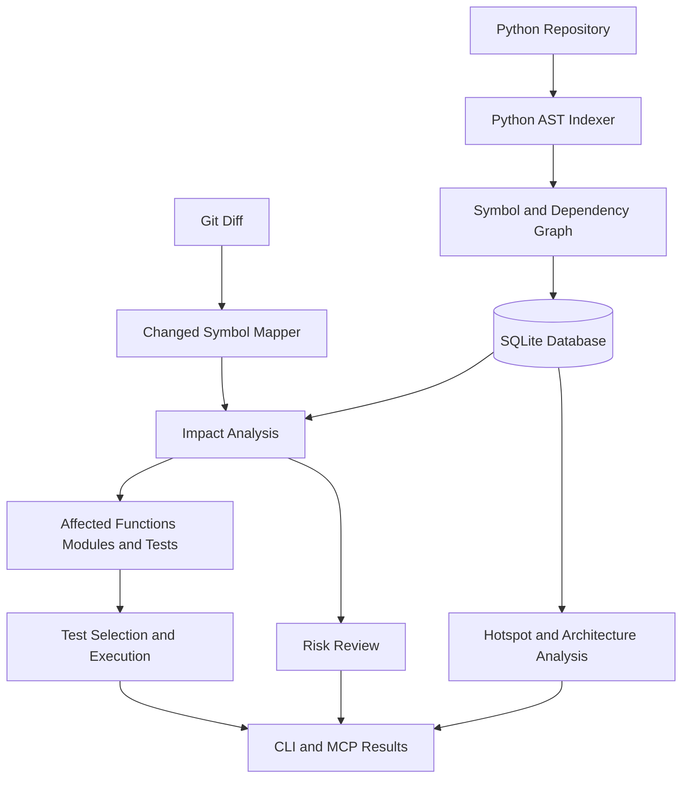

# CodeAtlas

**Code intelligence for Python repositories — understand change impact, identify relevant tests, and assess pull-request risk.**

CodeAtlas is a code intelligence tool that works as an **MCP server for AI assistants** and a **CLI for developers and CI pipelines**. It builds a persistent graph of symbols, imports, function calls, and related code relationships to help developers understand how a code change may affect the rest of a Python codebase.

Traditional search tools find where a function is mentioned. CodeAtlas goes further by analyzing code relationships, tracing potential impact, selecting relevant tests, and explaining factors that may make a change risky.

> Change a function. Understand what could break, which tests matter, and how risky the change is — before you merge.

---

## Table of Contents

- [Why CodeAtlas?](#why-codeatlas)
- [Key Features](#key-features)
- [Architecture](#architecture)
- [How It Works](#how-it-works)
- [Technology Stack](#technology-stack)
- [Installation](#installation)
- [Quick Start](#quick-start)
- [CLI Commands](#cli-commands)
- [Example: Change Impact Analysis](#example-change-impact-analysis)
- [Regression Detection Demonstration](#regression-detection-demonstration)
- [MCP Integration](#mcp-integration)
- [CI Integration](#ci-integration)
- [Storage and Configuration](#storage-and-configuration)
- [Risk Analysis and Test Selection](#risk-analysis-and-test-selection)
- [Architecture Health](#architecture-health)
- [Security Considerations](#security-considerations)
- [Known Limitations](#known-limitations)
- [Roadmap](#roadmap)
- [Contributing](#contributing)
- [License](#license)

---

## Why CodeAtlas?

When developers modify a function in a large repository, several questions arise:

- Which functions and modules depend on this change?
- Which tests should be executed?
- Could the change break downstream functionality?
- Are important code paths insufficiently tested?
- Which files have accumulated high complexity and frequent changes?
- How can an AI coding assistant understand the impact of a proposed change?

Running every test after every small change can be expensive. Running only tests that directly cover the changed function can miss regressions in dependent modules.

CodeAtlas addresses this problem through persistent code indexing, Git-aware change analysis, dependency tracing, and affected-test selection.

## Key Features

| Feature | Description |
|---|---|
| Persistent code indexing | Stores code symbols and relationships in a persistent graph backed by SQLite. |
| Symbol discovery | Locates function and class definitions. |
| Reference analysis | Identifies references and potential callers using available graph relationships. |
| Change impact analysis | Identifies potentially affected functions, modules, and tests. |
| Git-aware analysis | Analyzes changes between Git revisions. |
| Affected-test selection | Selects test files associated with the affected dependency graph. |
| Automated test execution | Runs selected tests and reports passes, failures, and errors. |
| Change risk review | Reports a heuristic risk score and supporting reasons. |
| Hotspot detection | Identifies files with elevated churn and complexity, where supported by the implementation. |
| Architecture health | Provides structural analysis such as import-cycle detection and complex-function identification, where implemented. |
| MCP integration | Makes supported code intelligence operations available to compatible AI assistants. |
| CLI integration | Provides commands for local development and potential CI workflows. |

CodeAtlas uses static analysis, so its findings represent potential impact rather than a guarantee that every runtime dependency has been discovered.

---

## Architecture



### Core Components

**1. Python AST Indexer**

Parses Python source code and extracts supported definitions, imports, function calls, and other structural information.

**2. Persistent Code Graph**

Stores code entities and their relationships so subsequent operations can query the indexed repository.

**3. Git Change Analyzer**

Uses Git revision comparisons to identify changed files and map changes to affected symbols where possible.

**4. Impact Analysis Engine**

Traverses available dependency relationships to identify potentially affected code.

**5. Test Selection Engine**

Uses dependency information to select candidate test files and invokes the test runner.

**6. Risk Review Engine**

Combines available signals, such as change impact, complexity, hotspots, and test reachability, to provide a heuristic assessment.

**7. CLI and MCP Interfaces**

Expose supported operations to developers, automation tools, and compatible AI assistants.

---

## How It Works

### Step 1: Index the repository

CodeAtlas parses the Python repository and records supported symbols and dependency relationships.

```powershell
codeatlas index --repo "C:\path\to\your\python-project"
```

### Step 2: Persist the analysis

CodeAtlas stores the code graph and indexing metadata in SQLite. Content hashes can be used to determine which files need to be reparsed during subsequent indexing, depending on the indexing implementation.

### Step 3: Detect changes

Git provides the changed-file information for the requested revision range.

CodeAtlas maps changed lines to the affected symbols where its static analysis can resolve them.

### Step 4: Trace potential impact

The analyzer follows available call and import relationships to identify functions, modules, and tests that may be affected.

### Step 5: Select relevant tests

The test-selection engine identifies candidate tests based on the dependency graph and invokes the configured test runner.

### Step 6: Review the results

CodeAtlas reports information such as:

- Changed symbols
- Potentially affected modules
- Risk score and contributing reasons
- Selected test files
- Passed and failed tests
- Failure messages and process exit status

### Step 7: Make a decision

Developers can use the results to investigate a regression, modify the implementation, run further tests, and decide whether the change is ready for review.

---

## Technology Stack

The project is designed around the following technologies and concepts. Verify the dependencies and implementations in the current checkout before treating every item as a confirmed implementation detail.

| Technology | Purpose |
|---|---|
| Python | Core implementation |
| Python AST | Static source-code analysis |
| SQLite | Persistent graph and indexing storage |
| Git | Change and revision analysis |
| pytest | Python test execution in the demonstrated workflow |
| MCP | Integration with AI coding assistants |
| CLI | Local development and automation |
| GitHub Actions | Potential continuous integration integration |
| Docker | Potential isolated execution and deployment |

---

## Installation

### Requirements

- Python version compatible with the project's dependencies
- Git
- pip
- A Python repository to analyze
- Node.js and `npx` if using MCP Inspector
- An MCP-compatible client if using AI-assisted analysis

### 1. Clone CodeAtlas

Replace the example URL with your actual repository URL.

```powershell
git clone <YOUR_CODEATLAS_REPOSITORY_URL>
cd codeatlas
```

Use the directory containing `pyproject.toml` as the project root.

### 2. Create a virtual environment

**Windows PowerShell**

```powershell
python -m venv .venv
.\.venv\Scripts\Activate.ps1
```

**Linux / macOS**

```bash
python -m venv .venv
source .venv/bin/activate
```

### 3. Install dependencies

```bash
python -m pip install --upgrade pip
pip install -r requirements.txt
pip install -e .
```

Run these commands from the CodeAtlas project directory.

### 4. Run the project tests

```bash
python -m pytest tests -q
```

This checks the tests available in your checkout. The actual result depends on the current implementation and environment.

---

## Quick Start

The following example uses Windows PowerShell.

### 1. Configure repository access

Set the root directory that CodeAtlas is allowed to access:

```powershell
$env:CODEATLAS_ROOTS = "C:\Users\YourUser\OneDrive\Desktop"
```

Replace the path with the directory containing your target repositories.

This setting applies to the current PowerShell session. Configure it again in a new terminal if needed.

### 2. Index a repository

```powershell
codeatlas index --repo "C:\path\to\your\python-project"
```

An initial indexing operation may report statistics such as:

```json
{
  "files": 7,
  "reparsed": 7,
  "removed": 0,
  "symbols": 13,
  "calls": 26,
  "imports": 9,
  "parse_errors": [],
  "full_reindex": true
}
```

These values are an example of the output observed during development on a sample repository, not a guarantee for every repository.

### 3. Review a Git change

```powershell
codeatlas review --repo "C:\path\to\your\python-project" --range HEAD~1..HEAD
```

The range `HEAD~1..HEAD` compares the current commit against its immediate parent.

### 4. Run affected tests

```powershell
codeatlas test --repo "C:\path\to\your\python-project" --range HEAD~1..HEAD
```

CodeAtlas reports the selected test files and the execution results.

For pull requests, choose a Git range whose base and head represent the intended comparison. Ensure the base revision is available locally.

---

## CLI Commands

The following commands are part of the demonstrated CLI workflow.

### Index a repository

```powershell
codeatlas index --repo "C:\path\to\repo"
```

Builds or updates the repository index.

### Review changes

```powershell
codeatlas review --repo "C:\path\to\repo" --range HEAD~1..HEAD
```

Reports changed symbols, risk information, and suggested tests.

### Run selected tests

```powershell
codeatlas test --repo "C:\path\to\repo" --range HEAD~1..HEAD
```

Selects candidate test files, executes them, and reports the results.

Other commands and MCP tools should be documented according to their actual names and behavior in the installed version.

---

## Example: Change Impact Analysis

Consider a Python application with pricing, checkout, and order-processing modules.

```text
myapp/
├── shop/
│   ├── __init__.py
│   ├── pricing.py
│   ├── checkout.py
│   └── orders.py
└── tests/
    ├── test_pricing.py
    ├── test_checkout.py
    └── test_orders.py
```

Suppose the pricing module contains:

```python
def clamp(value: float, minimum: float, maximum: float) -> float:
    """Keep a value inside an inclusive range."""
    return max(minimum, min(value, maximum))
```

Other functions use this helper to constrain discount rates and calculate checkout totals.

For example, the dependency chain might look like:

```text
clamp()
  └── calculate_discount()
       └── discounted_total()
            └── checkout_total()
                 └── create_order()
```

If `clamp()` changes, the consequences may extend beyond `pricing.py`.

CodeAtlas can use its indexed relationships to identify potential downstream effects, suggest tests, and help developers investigate whether the change introduces a regression.

Actual results depend on the repository and the relationships successfully resolved by static analysis.

---

## Regression Detection Demonstration

CodeAtlas was tested against a sample Python repository containing pricing, checkout, and order-processing modules.

A regression was deliberately introduced into `shop.pricing.clamp` to evaluate the change-review and affected-test workflows.

### 1. Analyze the change

```powershell
codeatlas review --repo "C:\path\to\codeatlas_test_repo" --range HEAD~1..HEAD
```

The observed review identified:

```json
{
  "risk_level": "low",
  "risk_score": 10,
  "suggested_tests": [
    "tests/test_checkout.py",
    "tests/test_orders.py",
    "tests/test_pricing.py"
  ],
  "changed_symbols": [
    {
      "symbol": "shop.pricing.clamp",
      "file": "shop/pricing.py",
      "complexity": 1
    }
  ]
}
```

The review also reported that five dependent modules might be affected and that `shop/pricing.py` was a churn/complexity hotspot.

### 2. Run the selected tests

```powershell
codeatlas test --repo "C:\path\to\codeatlas_test_repo" --range HEAD~1..HEAD
```

### 3. Observed results

| Metric | Result |
|---|---:|
| Selected test files | 3 |
| Passed tests | 1 |
| Failed tests | 6 |
| Errors | 0 |
| Skipped tests | 0 |
| Exit code | 1 |
| Reported test savings | 0% |

The selected tests included pricing, checkout, and order-processing tests.

### 4. Understand the regression

The intentionally incorrect implementation was:

```python
return min(minimum, max(value, maximum))
```

The correct implementation is:

```python
return max(minimum, min(value, maximum))
```

For example:

| Input | Correct output |
|---|---:|
| `clamp(5, 0, 10)` | `5` |
| `clamp(-5, 0, 10)` | `0` |
| `clamp(15, 0, 10)` | `10` |

The incorrect implementation returned unexpected values, causing failures in direct pricing tests and downstream checkout and order calculations.

### What this demonstrates

This experiment demonstrates that CodeAtlas can:

1. Index a sample Python repository.
2. Identify a changed function from a Git revision range.
3. Produce a change-risk report.
4. Select related test files.
5. Execute the selected tests.
6. Report test failures and a nonzero exit code.

It does not yet establish the tool's overall regression-detection rate, scalability, or performance advantage over running the complete test suite.

**Important:** The observed risk score was low despite six test failures. Risk scores are heuristic assessments, not calibrated probabilities of a defect. This is an important area for further improvement.

---

## MCP Integration

The Model Context Protocol (MCP) allows compatible AI assistants to call tools exposed by a server.

CodeAtlas can provide a structured interface for code intelligence operations, allowing an assistant to request supported analyses and interpret the returned evidence.

### Option 1: MCP Inspector

If the MCP server entry point is installed and available on your executable path, start the Inspector with:

```bash
npx @modelcontextprotocol/inspector codeatlas-mcp
```

Follow the Inspector interface to connect to the server and inspect its available tools.

The exact launch command depends on the installed MCP SDK, entry point, and configuration.

### Option 2: Claude Code

For a compatible Claude Code installation, an example configuration command is:

```bash
claude mcp add codeatlas \
  -e CODEATLAS_ROOTS="C:\path\to\allowed\repositories" \
  -- codeatlas-mcp
```

Check the available MCP servers:

```bash
claude mcp list
```

Confirm the command and environment-variable syntax against your installed Claude Code version.

### Example interactions

Once connected, an AI assistant could use supported CodeAtlas tools to help answer questions such as:

- Which functions depend on `clamp()`?
- What might break if I modify this function?
- Which tests should I run for this change?
- What do the selected test failures indicate?
- Which files have elevated complexity and change frequency?

MCP provides the communication interface. CodeAtlas remains responsible for the analysis and operations implemented by its tools.

---

## CI Integration

CodeAtlas can be integrated into continuous integration workflows to analyze pull-request changes and execute selected tests.

A typical workflow is:

1. Check out the repository and the relevant base revision.
2. Set up Python and install project dependencies.
3. Install CodeAtlas.
4. Index the target repository.
5. Analyze the proposed changes.
6. Execute selected tests.
7. Publish the results or fail the job when required checks fail.

For example, a CI job could invoke:

```bash
codeatlas review --repo . --range BASE_SHA..HEAD_SHA
codeatlas test --repo . --range BASE_SHA..HEAD_SHA
```

Replace `BASE_SHA` and `HEAD_SHA` with actual revision values supplied by the CI environment.

Before relying on these commands in a production pipeline, verify that the workflow handles:

- Missing base revisions
- Dependency and configuration changes
- Test-selection failures
- Test-runner failures
- Repositories requiring a full-suite fallback

Do not assume that a successful subset of tests proves that the entire application is correct.

If a GitHub Actions workflow is included in the repository, document its actual path and validate it against a real pull request before advertising it as production-ready.

---

## Storage and Configuration

### Persistent graph

CodeAtlas uses SQLite for persistent analysis data. The database stores graph and indexing information outside the analyzed repository, according to the project's configured storage behavior.

Keeping analysis data outside the target repository helps avoid adding generated graph artifacts to application source control.

### Environment variables

| Variable | Purpose |
|---|---|
| `CODEATLAS_ROOTS` | Restricts the repository directories CodeAtlas may access. |
| `CODEATLAS_HOME` | Configures the location for persistent CodeAtlas state, if supported by the implementation. |

Example for Windows PowerShell:

```powershell
$env:CODEATLAS_ROOTS = "C:\Users\YourUser\OneDrive\Desktop"
```

Use the directory paths and environment variables supported by your installed version.

---

## Risk Analysis and Test Selection

CodeAtlas provides risk information to help developers prioritize code review.

### Blast radius

Estimates the potential scope of a change using available dependency relationships.

### Hotspots

Highlights files that combine code complexity and change frequency, where the relevant analysis is implemented.

### Test reachability

Helps identify whether changed code is connected to the tests recognized by the analysis.

### Affected tests

Selects candidate tests associated with the affected dependency graph.

### Risk score

Combines available signals to produce a heuristic assessment and supporting reasons.

A low score should not be interpreted as proof of safety. Risk estimates depend on graph completeness, dependency resolution, test information, and the scoring algorithm.

The usefulness of test selection should be evaluated against full-suite runs using representative changes, including regressions that affect indirect callers.

---

## Architecture Health

CodeAtlas may also provide structural analysis for identifying maintainability issues.

Potential analyses include:

- **Import cycles:** Detecting circular relationships among modules.
- **Dead-code candidates:** Identifying symbols that appear unused.
- **Complex functions:** Highlighting functions with elevated complexity.
- **Churn and complexity:** Prioritizing files for potential refactoring.

These findings are candidates for investigation rather than proof that a function is unnecessary or defective.

Verify that each analysis is implemented and available in your current version before relying on it.

---

## Security Considerations

CodeAtlas analyzes source code, but test execution can run arbitrary project code. Treat repository access and test execution as security-sensitive operations.

- **Path allowlisting:** Configure `CODEATLAS_ROOTS` to restrict accessible repositories.
- **Read-only indexing:** Static analysis should not modify application source files.
- **Explicit test execution:** Test commands may execute arbitrary Python code and build scripts from the target repository.
- **Untrusted repositories:** Use isolated containers or restricted CI runners for unknown code.
- **Least privilege:** Avoid exposing credentials, private directories, or unrelated files to an MCP server.
- **Persistent state:** Protect the graph database and its parent directory using appropriate filesystem permissions.
- **MCP access:** Expose tools only to authorized users and clients.

A path allowlist alone is not a sandbox. Use operating-system permissions and process isolation when analyzing untrusted repositories.

---

## Known Limitations

- **Python-focused analysis:** The project currently targets Python. JavaScript and TypeScript support should be treated as future work unless implemented separately.
- **Static call resolution:** Dynamic dispatch, `getattr`, decorator-registered callbacks, monkeypatching, and runtime-generated calls may not be fully tracked.
- **Reference ambiguity:** Name-based matches can be less reliable than fully resolved relationships.
- **Test selection:** Dependency relationships do not prove complete runtime coverage.
- **Risk estimation:** Risk levels depend on the completeness of the graph and the scoring model; they are not probabilities of failure.
- **Dead-code analysis:** Public APIs and dynamically accessed symbols may appear unused.
- **Performance claims:** Test-time savings must be measured against a full-suite baseline.
- **Repository scale:** Performance on large, complex repositories should be benchmarked before making scalability claims.

CodeAtlas should be treated as an additional source of evidence for code review, not a replacement for comprehensive testing or human judgment.

---

## Roadmap

Potential improvements include:

- Coverage-based test selection
- More accurate risk scoring using dependency reach and test evidence
- Better dynamic-call resolution
- GitHub pull-request summaries and automated checks
- Historical risk and test-time analytics
- Richer dependency graph visualizations
- JavaScript and TypeScript support
- More extensive benchmarking on real-world repositories

These are potential future improvements, not claims about existing functionality.

---

## Contributing

Contributions are welcome.

1. Fork the repository.
2. Create a feature branch.
3. Implement the change and add appropriate tests.
4. Run the test suite:

   ```bash
   python -m pytest tests -q
   ```

5. Document the expected behavior and any limitations.
6. Submit a pull request with relevant test results.

Changes to dependency analysis and test selection should include examples that cover both expected relationships and important edge cases.

---

## License

Add your chosen open-source license and include the corresponding `LICENSE` file before publishing the project.

No specific license is assumed by this README.

---

**CodeAtlas — Know what your code change can affect before you merge it.**
